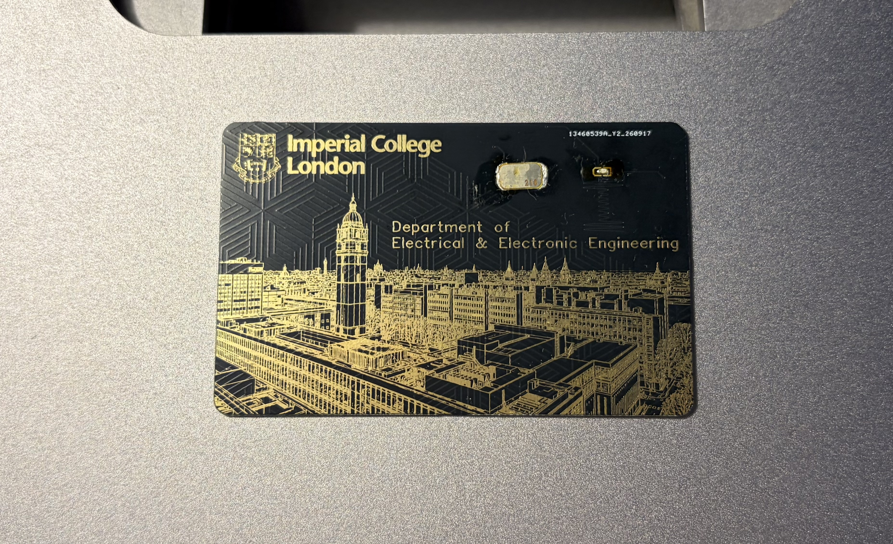
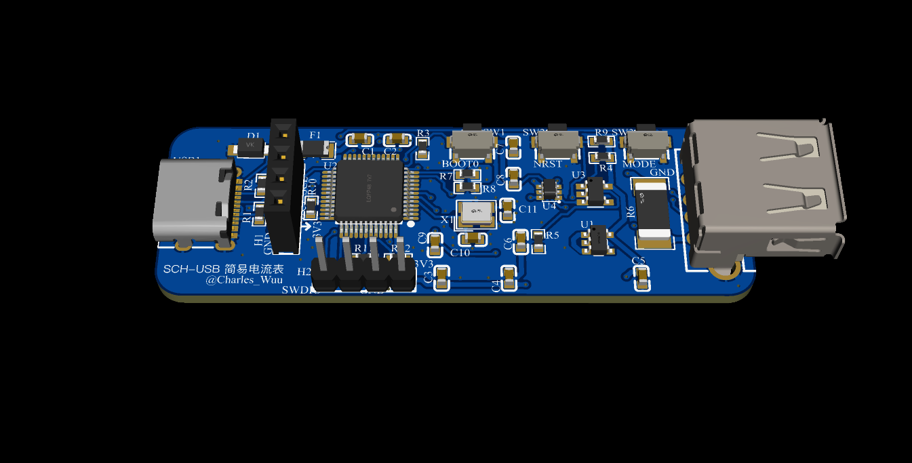
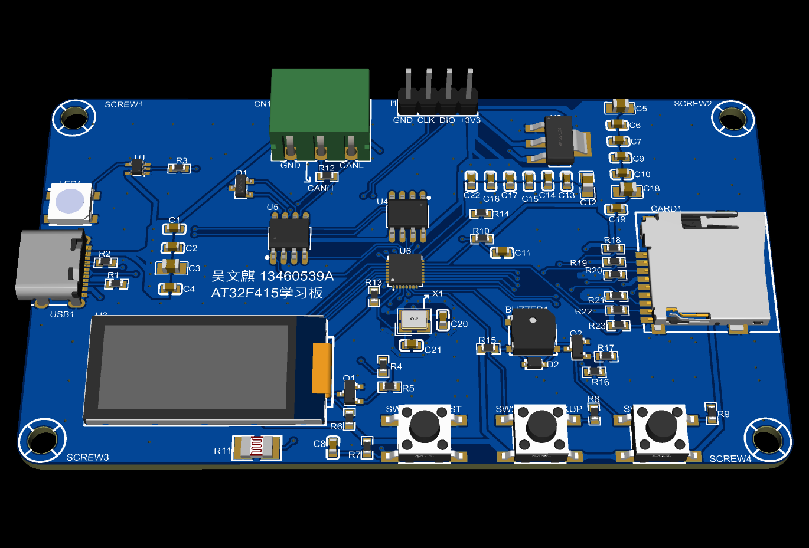

# PCB Design Portfolio

This repository brings together the projects I worked on while learning and practising PCB layout over the summer, from layout exercises to a board I fabricated, soldered, and tested myself.

I have earned an entry-level PCB Layout Designer certificate issued by the [Chinese Institute of Electronics (CIE)](https://www.cie.org.cn/about_107/).

## Projects

| Project | Validation status |
| --- | --- |
| [**NFC LED Campus Card**](nfc_led_campus_card/)  | Fabricated, soldered, and tested successfully. LED illumination, NFC reading and writing, and access-control operation have been verified. |
| [**USB Voltage and Current Meter**](usb_voltage_current_meter/)  | A PCB layout practice project that passed design rule checks (DRC). It has not yet been fabricated or tested in hardware; hardware validation is still required. |
| [**AT32F415 Development Board**](at32f415_development_board/)  | My certification exam submission. The layout passed DRC and professional assessment, and I successfully earned my certificate. |

EL.PSY.KONGROO
