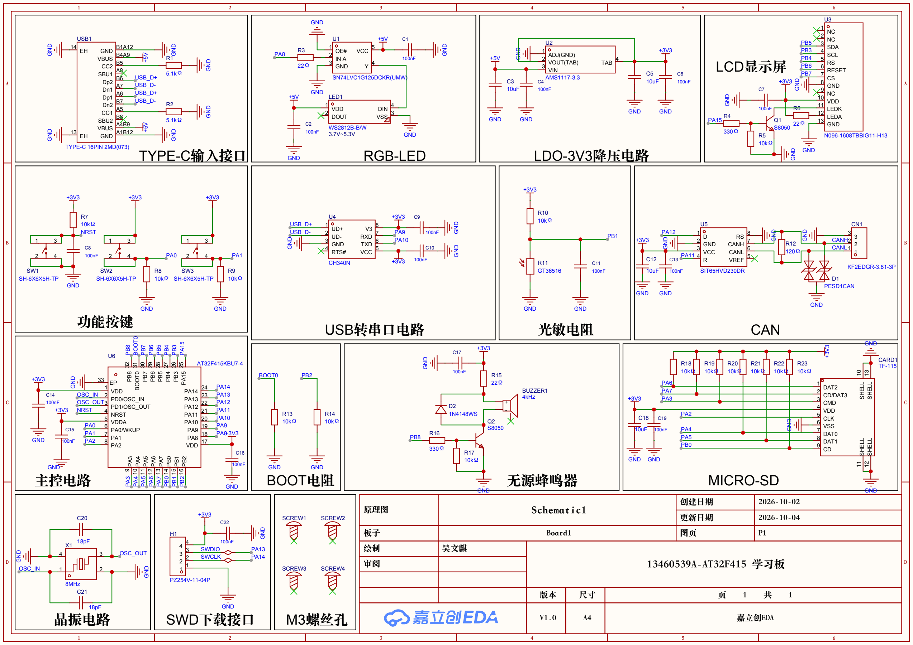
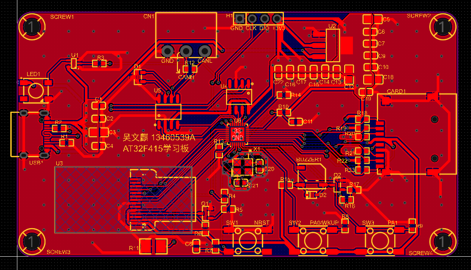
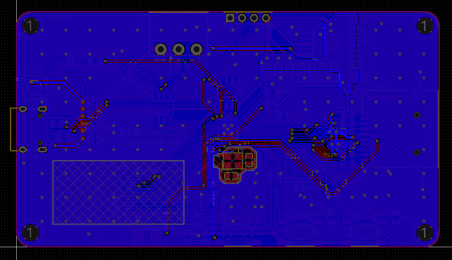
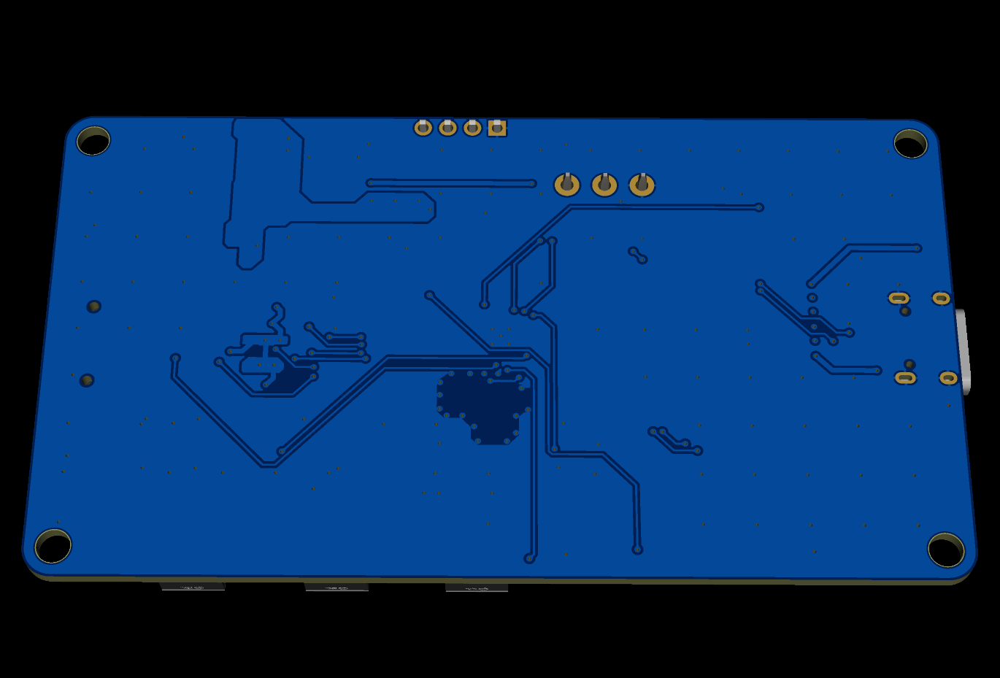

# AT32F415 Development Board

This AT32F415 development board was my PCB layout certification exam submission. The layout passed **design rule checks (DRC) with no reported violations** and the exam's **professional assessment**.

I successfully passed the exam and earned an entry-level PCB Layout Designer certificate issued by the [Chinese Institute of Electronics (CIE)](https://www.cie.org.cn/about_107/).

## Project files

- [Original design project (.epro2)](hardware/at32f415_development_board.epro2) — open in EasyEDA Pro / LCEDA Pro.
- [Schematic (.pdf)](hardware/at32f415_development_board_schematic.pdf)
- [Bill of materials (.xlsx)](hardware/at32f415_development_board_bom.xlsx)
- [Project images](docs/images/)

## Schematic

## PCB layout

| Top | Bottom |
| --- | --- |
|  |  |

## 3D previews

| Top | Bottom |
| --- | --- |
|  |  |

[Back to the portfolio](../)
