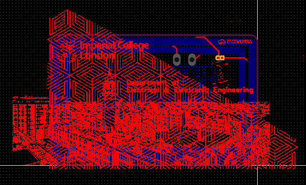
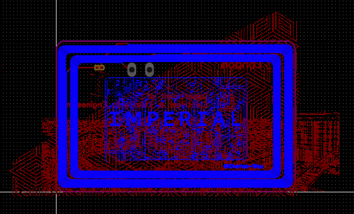
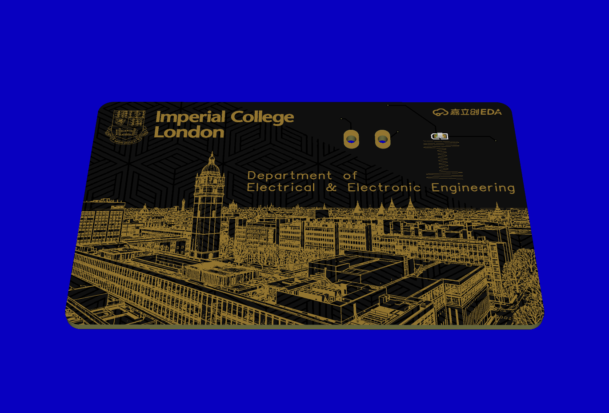
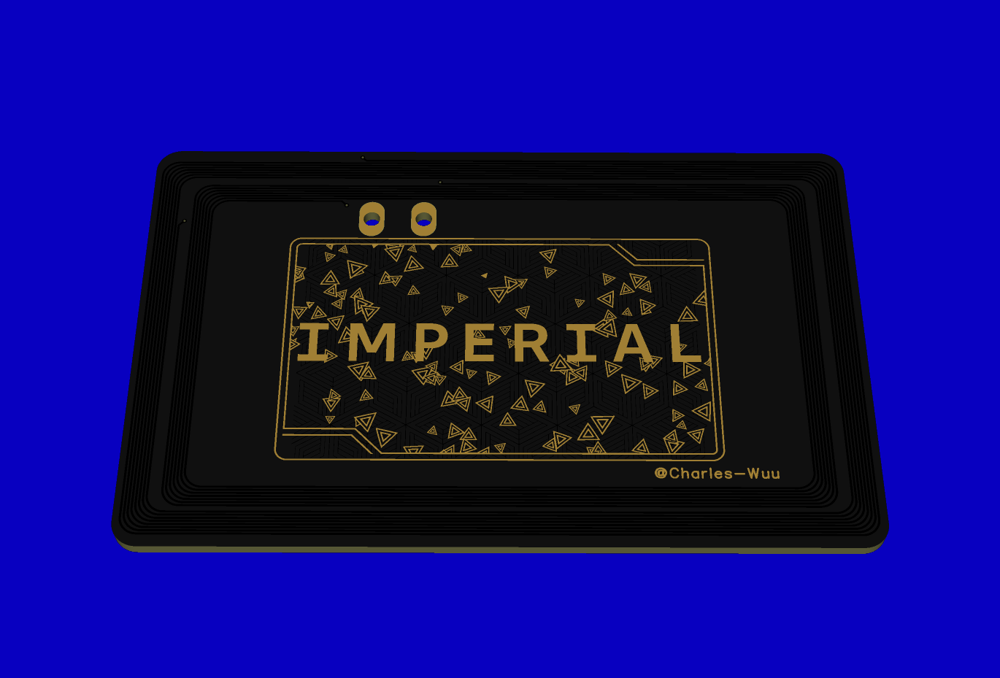
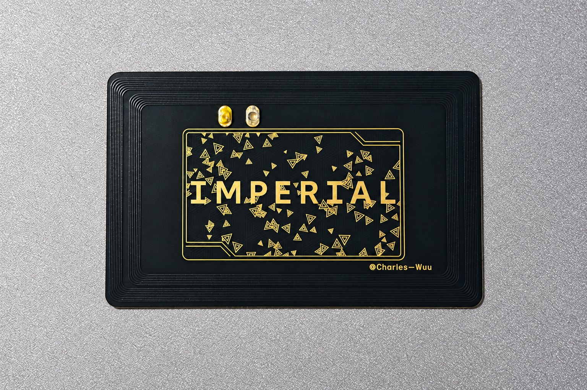

# NFC LED Campus Card

A personal PCB campus card project inspired by Imperial College London's Department of Electrical and Electronic Engineering (EEE). I designed the board, had it fabricated, and soldered and tested the assembled card myself.

## How it works

The card combines an NFC chip with a [KT-0603R surface-mount LED](https://www.lcsc.com/datasheet/C2286.pdf) in a **0603 package (1.6 × 0.8 mm)**. Two separate PCB coils pick up energy from a compatible reader's alternating magnetic field through electromagnetic induction: one powers the NFC chip, and the other powers the LED. When the card is held close enough to the reader, the LED lights up.

With compatible credentials configured and recognised by the reader, the NFC chip can support functions such as campus or home access, as well as other compatible NFC applications. The assembled card has passed tests for **LED illumination, NFC reading and writing, and access-control operation**.

## Project files

- [Original PCB project (.epro2)](hardware/nfc_led_campus_card.epro2) — open in EasyEDA Pro / LCEDA Pro.
- [Project images](docs/images/)

## PCB layout

| Top | Bottom |
| --- | --- |
|  |  |

## 3D previews

| Top | Bottom |
| --- | --- |
|  |  |

## Assembled card

| Front | Back |
| --- | --- |
|  |  |

[Back to the portfolio](../)
