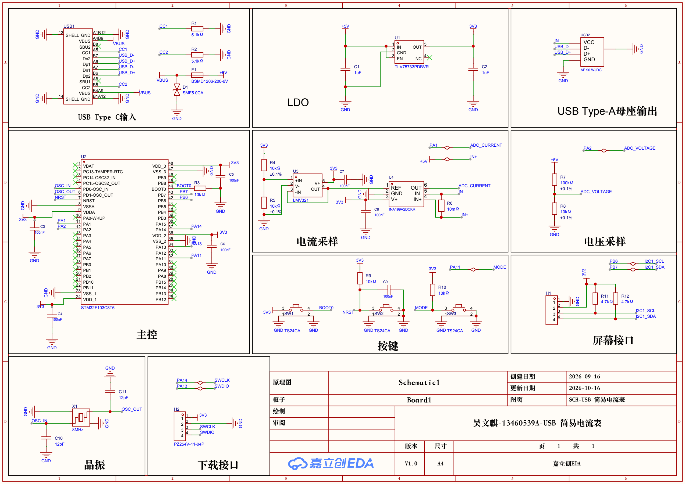
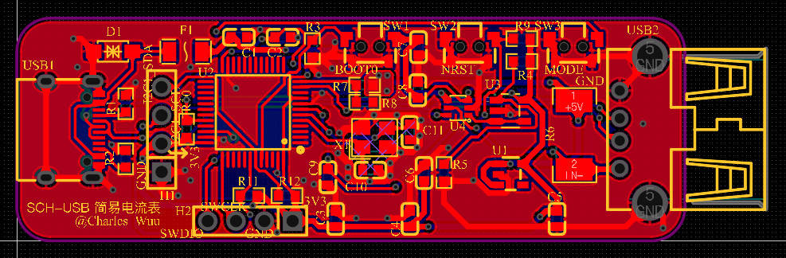
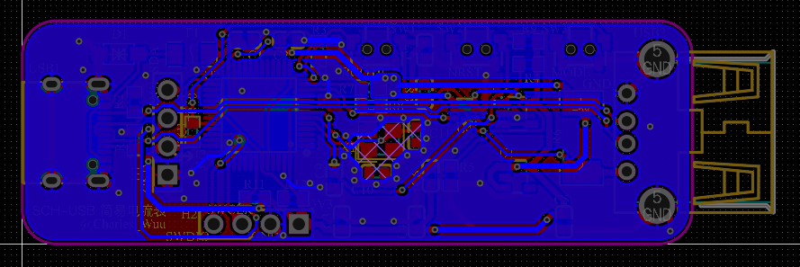
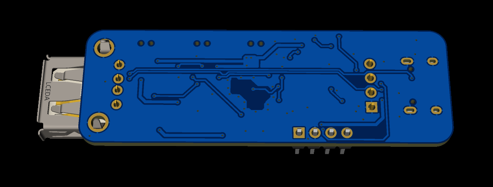

# USB Voltage and Current Meter

I designed this simple USB voltage and current meter as a practice project while learning PCB layout.

The design is based on the [STM32F103C8T6](https://www.st.com/en/microcontrollers-microprocessors/stm32f103c8.html) microcontroller, with a USB Type-C connector for power input and a USB Type-A connector for the load.

A **10 mΩ shunt resistor** and an [INA199](https://www.ti.com/product/INA199) current-sense amplifier provide the current measurement signal, while a resistor divider scales the supply voltage for measurement. The STM32 is designed to sample these signals through its ADC, calculate the voltage and current, and send the readings to an external display module over I2C.

The board also includes a **3.3 V regulator**, a mode-selection button, an **8 MHz crystal**, and an **SWD interface** for programming and debugging.

The PCB layout has passed **all design rule checks (DRC) with no reported violations**. The board has not yet been fabricated or tested in hardware, so its electrical operation and measurement performance still require validation.

## Project files

- [Original design project (.epro2)](hardware/usb_voltage_current_meter.epro2) — open in [EasyEDA Pro](https://pro.easyeda.com/editor) / [LCEDA Pro](https://pro.lceda.cn/editor).
- [Schematic (.pdf)](hardware/usb_voltage_current_meter_schematic.pdf)
- [Bill of materials (.xlsx)](hardware/usb_voltage_current_meter_bom.xlsx)
- [Project images](docs/images/)

## Schematic

## PCB layout

| Top | Bottom |
| --- | --- |
|  |  |

## 3D previews

| Top | Bottom |
| --- | --- |
|  |  |

[Back to the portfolio](../)
